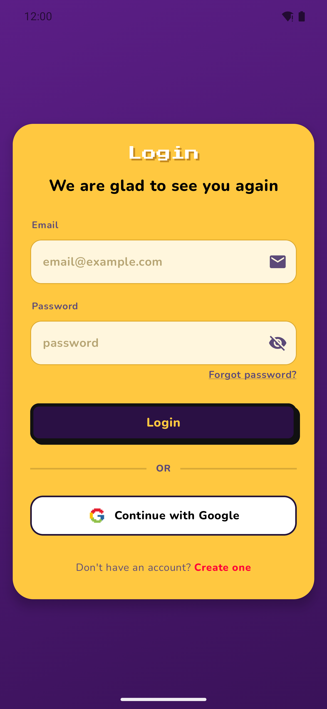
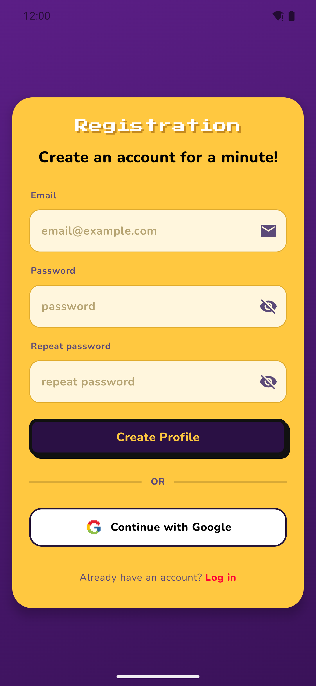
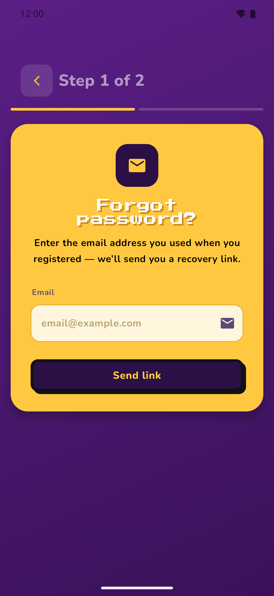
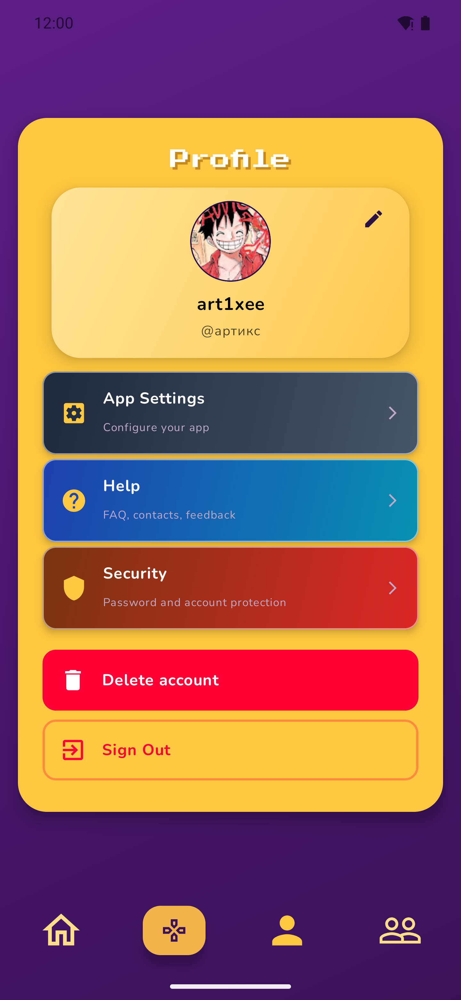
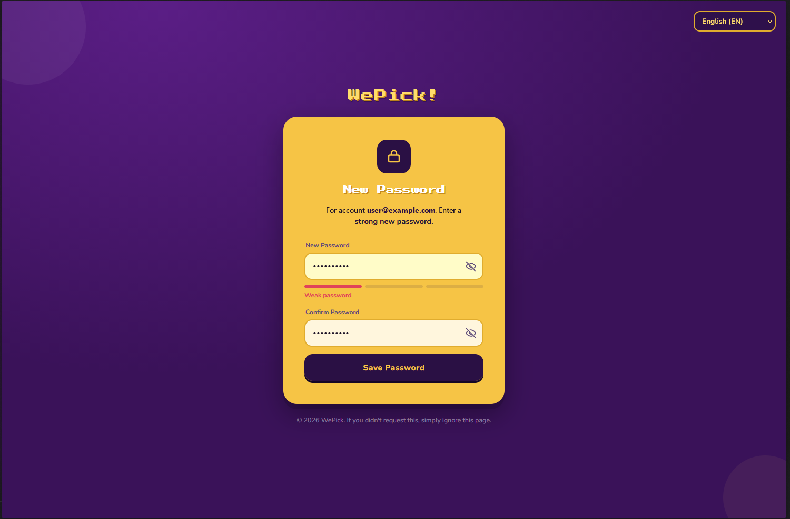

# WePick!

Android app that helps two people agree on what to watch. Pick a content type (movies, TV series or anime), choose a partner (a friend or a popular character), select genres, and WePick! finds titles that match both sets of preferences.

Built with Kotlin and Jetpack Compose.

## Screenshots

| Login | Sign up | Forgot password | Profile |
|---|---|---|---|
|  |  |  |  |

Password reset page (web), opened from the link in the reset email:



<!-- TODO: add genres.png and match.png when these screens are finished -->

## Features

- Email and Google sign-in (Firebase Authentication, Credential Manager), password reset
- User profile with avatar stored in Firebase Cloud Storage, profile data in Cloud Firestore
- Friends: friend requests and friend profiles
- Content discovery from two REST APIs: TMDB (movies, TV series) and Jikan (anime)
- Genre-based matching of two users' preferences, results shown in batches
- Favorites list
- Push notifications via Firebase Cloud Messaging
- English and Russian localization, in-app language switch

## Tech stack

| Area | Tools |
|---|---|
| Language | Kotlin |
| UI | Jetpack Compose, Material 3, Navigation Compose |
| Architecture | MVVM, ViewModel, unidirectional data flow |
| Async | Kotlin Coroutines (`async` / `awaitAll`, job cancellation) |
| Network | Retrofit, OkHttp, Gson |
| Backend | Firebase Authentication, Cloud Firestore, Cloud Storage, Cloud Messaging |
| Images | Coil |
| CI | GitHub Actions |

## Technical highlights

- **Parallel paginated requests.** TMDB pages are loaded concurrently with `async` / `awaitAll`, then merged and deduplicated by id.
- **Rate-limit aware loading.** Jikan requests are sequential with a delay between pages and a retry pause, to respect the API rate limit.
- **Cancellation.** A new matching request cancels the previous coroutine job, so stale results never reach the UI.
- **Repository for user data.** `UserRepository` interface in `domain/`, Firebase implementation in `data/repository/`.

## Project structure

```
app/src/main/java/com/example/wepick/
  data/          models, Retrofit services, Firebase repository
  domain/        repository interfaces
  viewmodel/     ViewModels (auth, content, profile, main flow)
  screens/       Compose screens (auth, friends, profile, matching flow)
  navigation/    NavHost and routes
  messaging/     FCM service
  ui/            theme and shared components
  util/          constants, locale helpers, settings
```

## Getting started

Requirements: Android Studio (latest stable), JDK 17, Android SDK 36.

1. Clone the repository.
2. Get a free API key at [themoviedb.org](https://www.themoviedb.org/settings/api).
3. Add it to `local.properties` in the project root (this file is not committed):
   ```properties
   TMDB_API_KEY=your_key_here
   ```
4. Run the `app` configuration, or build from the command line:
   ```bash
   ./gradlew assembleDebug
   ```

The Firebase config (`app/google-services.json`) is included, so authentication and Firestore work out of the box with the project's Firebase instance.

## Roadmap

- [ ] Move TMDB / Jikan calls from `ContentViewModel` into a content repository
- [ ] Expose screen state as `StateFlow<UiState>` with Loading / Success / Error / Empty
- [ ] Unit tests for the matching and validation logic
- [ ] UI test for the main matching flow
- [ ] Dependency injection via constructor parameters (later Hilt)

## Author

Maksym Zubrytskyi, Junior Android Developer. [GitHub](https://github.com/art1xee)
